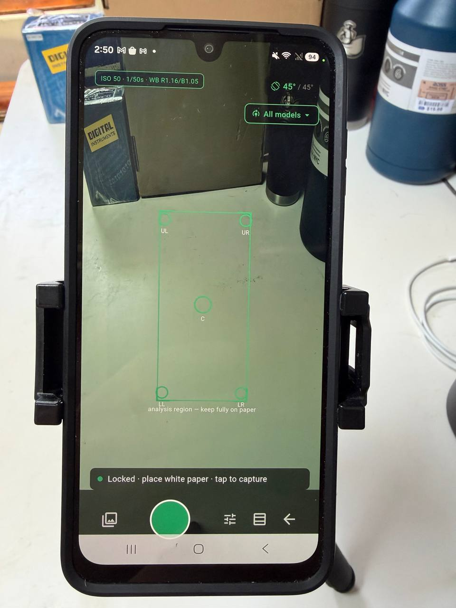
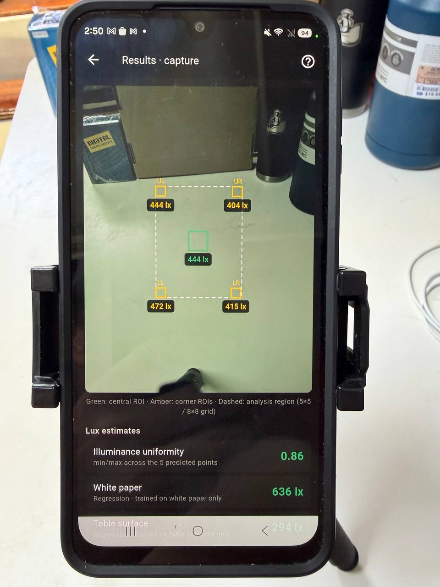

# AI Lux — smartphone illuminance estimation (research build)

AI Lux is an Android research app that estimates surface illuminance
(lux) from smartphone photographs using machine-learning models trained
on a controlled open dataset. The primary protocol evaluated to date uses
a white paper sheet placed on the surface as a standardized target.
Models for bare table surfaces are also included, but have not yet been
field-tested.

This tool addresses a practical need in occupational hygiene: rapid
preliminary screening of workplace illumination when follow-up measurement
with a calibrated lux meter may be needed. It estimates illuminance from
smartphone images and supports device-specific calibration against
lux-meter readings, with the goal of making initial lighting assessment
faster and more accessible.

The current release is a field-testing implementation of the AI
illuminance-estimation approach. It is designed to evaluate how models
trained on the project dataset perform when deployed on a smartphone under
real-world lighting, surface, and camera conditions. The application is
therefore both a research tool and a prototype screening aid, supporting
validation, calibration, and future refinement.

The application is not a certified or legally recognized measuring
instrument and should not replace formal compliance measurements with a
calibrated lux meter. It is intended to help identify locations where
follow-up measurement may be needed.

The application also supports a modular inference architecture that allows users to
deploy compatible trained machine-learning models. This enables
researchers and practitioners to evaluate alternative image-based
illuminance-estimation approaches on the same mobile platform using the
author's dataset, expanded datasets, or independently developed training
datasets. The goal is to facilitate reproducible comparison of models
under real-world conditions.

**Download:** see [Releases](../../releases/latest) for the latest APK
(sideload; Android will ask to allow installation from unknown sources).

## What it does

- **Two ways to analyze a photo:** the built-in camera with fixed exposure settings where supported (ISO 50 · 1/50 s · WB 4000 K, via Camera2), or
  importing a photo taken in a phone's Pro mode with the same settings.
- **A suite of bundled ML models** (ExtraTrees and a compact CNN,
  running on-device via ONNX Runtime): lux regression across three
  analysis geometries (full grid, A4-safe small area, center-only), a
  5-point spatial map with an illuminance-uniformity ratio, and 250/500
  lx threshold checks.
- **Per-device calibration**: named profiles per lighting context,
  monotone piecewise fitting, import/export of calibration files, and
  an on-device calibration-curve plot (exportable as PNG).
- **Measurement logging** to CSV — raw *and* calibrated values, device
  identity, room/lamp metadata — with one-tap sharing, plus a companion report-generation instruction file for converting logs into a formatted measurement report.
- **Custom model import**: models trained by others on the open dataset
  can be side-loaded (ONNX + feature list + metadata trio) without
  rebuilding the app.

## Why calibration matters (and when it may not)

The training dataset was collected with a **Samsung Galaxy A16 in Pro
mode at ISO 50 · 1/50 s · WB 4000 K**. Photos taken the same way on the
same phone model therefore fall close to the training distribution:
in preliminary checks, such imported photos showed ~4–9 % error
*without any calibration*. Every other configuration — the app's own
camera pipeline, other phone models, other settings — renders the scene
differently and benefits from per-device calibration. On the test
device, the in-app camera showed ~25–30 % raw error, reduced to
**~2–3 % after a 10–15-point calibration**; a calibration collected
under cold-white LED, applied unchanged to warm-white LED scenes, gave
3–5 %. These are preliminary single-device observations (~140
measurements against a reference lux meter), not a validation study;
how well this holds on other phones is exactly what volunteer testing
is investigating.

## How a measurement is taken

1. **Paper models** (the default): place a white paper sheet flat on
   the surface. An **A4 sheet is sufficient for the Fast preset**
   (small-area and center-only geometries). Full-grid models analyze a
   larger region — the paper must cover the entire dashed analysis
   region shown on screen, which may require a larger sheet or careful
   placement. **Table models** analyze the bare surface: no paper.
2. Hold the phone about **31 cm above the surface**, tilted **45°** —
   the on-screen angle indicator turns green in the 42–48° window.
3. Keep the dashed analysis region fully on the intended surface — the
   overlay shows exactly the area the selected model analyzes and
   adapts to the selected model.
4. For calibration or accuracy checks: read a reference lux meter at
   the center of the analysis region, **remove the meter from view**,
   then capture.
5. Fluorescent lamps need 1–3 minutes of warm-up before measuring.

## Models and transparency

All model files the app runs — ONNX weights, feature-order lists, and
metadata — are bundled in [`assets/models/`](assets/models) of this
repository, so the deployed models can be inspected directly. The
original model generation corresponds to the experiments in the
[ai-lux-estimation](https://github.com/buryianton/ai-lux-estimation)
repository; newer models (small-area and center-only geometries, the
CNN, and size-optimized retrains) were trained later on the same open
dataset, and their training scripts will be added to that repository.

## Research context

- Dataset (5,814 labeled photographs):
  [doi.org/10.5281/zenodo.20657011](https://doi.org/10.5281/zenodo.20657011)
- Dataset & experiment code:
  [ai-lux-estimation](https://github.com/buryianton/ai-lux-estimation)
- A *Data in Brief* article describing the dataset is under review; a
  validation article is in preparation.

## Intended use and limitations
AI Lux is intended for research, education, and preliminary screening of
workplace illumination. It may help identify locations where lighting
conditions should be checked with a calibrated lux meter. It is not
intended for regulatory compliance measurements, certification, legal
metrology, or replacement of certified photometers.

## Volunteer testing

Testers with an Android phone and a lux meter are welcome — the
instruction sheet (install, calibration protocol, measurement protocol,
result sharing) is included with each release. Per-device calibration
requires a reference lux meter.

## Building from source

Flutter (stable) + Android SDK. `flutter pub get`, then
`flutter build apk --release`. Models are bundled under
`assets/models/`.

## Development note

The application code and analysis scripts were written with substantial
assistance from AI tools (Anthropic Claude, OpenAI ChatGPT). Study
design, measurement protocols, dataset collection, experiments, and
interpretation of results are the author's; AI-generated code was
directed, tested, and field-verified by the author.

## Author

Anton Buryi — graduate student, Environmental and Occupational Health, CSUN

This project is an independent research/development project and does not
represent an official product or position of California State University,
Northridge.
